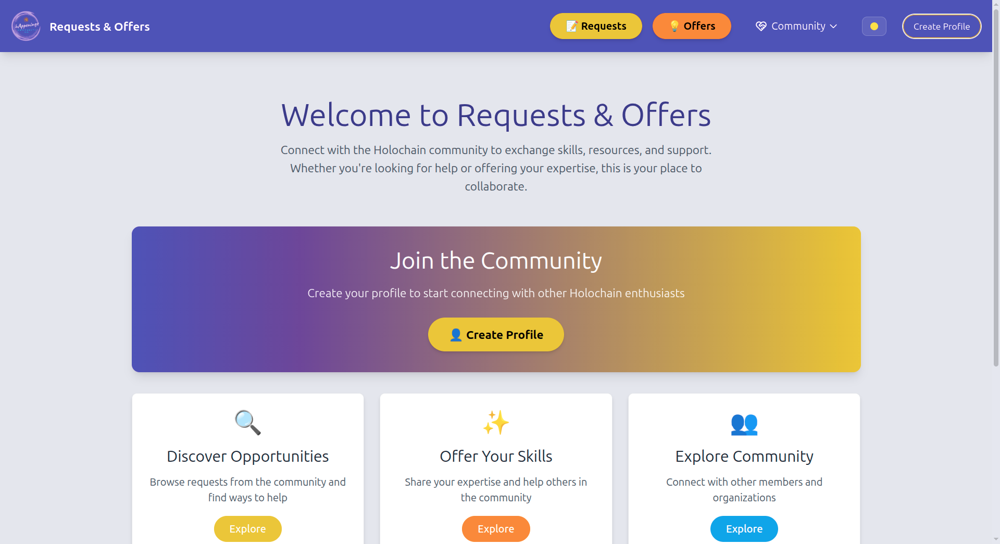
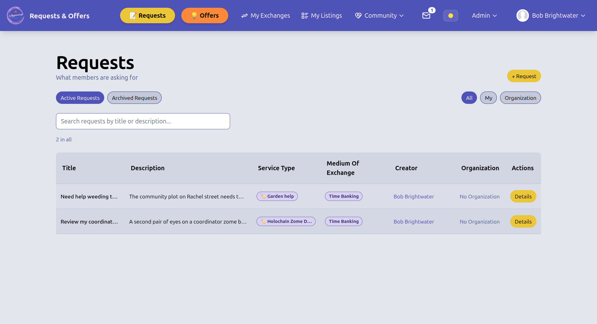
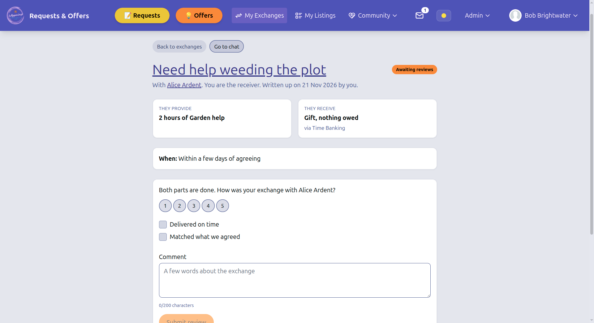
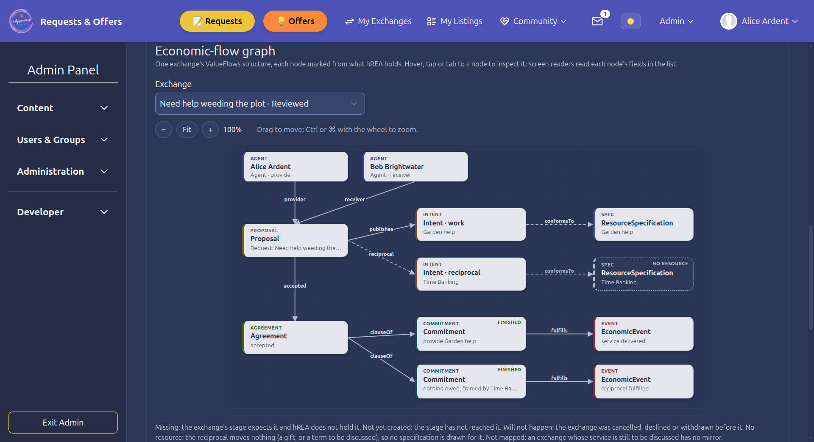

# Requests and Offers

<!-- release-ready: 0.6.0-alpha.2 -->
<!-- Raise this marker to the version being released once the README describes it; the release refuses a tag it does not name (scripts/release-readme.ts). -->

[](https://github.com/happenings-community/requests-and-offers/actions/workflows/ci.yml)
[](https://github.com/happenings-community/requests-and-offers/releases/latest)
[](https://happenings-community.github.io/requests-and-offers/)
[](LICENSE.md)
[](https://www.holochain.org/)
[](https://github.com/h-REA/hREA/releases/tag/happ-0.5.0-beta.1)
[](https://www.valueflo.ws/)
[](https://svelte.dev/)
[](https://effect.website/)
[](https://deepwiki.com/happenings-community/requests-and-offers)

A **peer-to-peer exchange network** for the Holochain community. Creators, developers and organizations post requests and offers for services, skills and resources, then carry an exchange through in the app: interest, proposals and counter-proposals, an agreement, completion and reviews, with encrypted messaging along the way. Every exchange is recorded in hREA as Valueflows commitments and economic events.

> [!WARNING]
> **This project is in alpha and is not production ready.** Expect breaking changes, incomplete features, and potential instability. Use at your own risk.



### A look inside

| Browse what members ask for | Carry an exchange through | See it in Valueflows |
|---|---|---|
| [](documentation/assets/screenshots/requests.png) | [](documentation/assets/screenshots/exchange-review.png) | [](documentation/assets/screenshots/hrea-economic-flow.png) |
| Requests and offers, each with one service type and the medium of exchange it accepts. | Interest, proposal, agreement, each side's completion, then a review from each member. | The same exchange mirrored into hREA: commitments fulfilled by economic events. |

## 📦 Install

Desktop builds for Windows, macOS (also through Homebrew) and Linux are on the [latest release](https://github.com/happenings-community/requests-and-offers/releases/latest); [INSTALL.md](INSTALL.md) walks through each one.
The hApp also runs as a Moss (Weave) tool: `bun applet-dev` starts it in a local Moss.

## 🚀 Quick Start

```bash
# Clone and setup
git clone https://github.com/happenings-community/requests-and-offers.git
cd requests-and-offers && nix develop
bun install && bun start
```

## 📖 Documentation

### Essential Reading

- **[📋 Project Overview](documentation/project-overview.md)** - Complete project introduction and features
- **[🚀 Quick Reference](documentation/QUICK_REFERENCE.md)** - Essential commands, patterns, and workflows
- **[🏗️ Architecture](documentation/architecture.md)** - System design and 7-layer Effect-TS architecture
- **[🔧 Developer Guide](documentation/guides/getting-started.md)** - Setup and development workflow
- **[🆘 Troubleshooting](documentation/TROUBLESHOOTING.md)** - Common issues and solutions
- **[📚 Full Documentation Index](documentation/DOCUMENTATION_INDEX.md)** - Comprehensive documentation catalog

### Quick Reference

- **Requirements**: [Overview](documentation/requirements.md) | [Features](documentation/requirements/features.md) | [Use Cases](documentation/requirements/use-cases.md)
- **Technical**: [API Reference](documentation/technical-specs/api/README.md) | [Zomes](documentation/technical-specs/zomes/README.md) | [Testing](documentation/guides/testing.md)
- **Community**: [Contributing](documentation/guides/contributing.md) | [Discord](https://discord.gg/happening) | [Website](https://happenings.community/)

## 🛠️ Development Commands

### Running the Application

```bash
# (from project root) 
# Development Mode - Full Holochain app with dev features
bun start              # Start complete Holochain app (2 agents by default)
AGENTS=3 bun start     # Custom number of agents
bun start:web          # Browser tabs, one URL per member; both open the conductor inspector
```

### Testing

```bash
bun test               # All tests
bun test:ui            # Frontend tests
bun test:unit          # Unit tests (no Nix needed)
bun test:integration   # Integration tests
```

### Building

```bash
bun build:zomes        # Build zomes
bun build:happ         # Build complete hApp
bun package            # Package for distribution
```

> **Note**: Unit tests do not need Nix; building zomes, the hApp and Sweettest does. Use `nix develop --command bun build:happ` for those.

## 🔧 Development Features System

The project uses **atomic environment-based feature control** through the DevFeatures Service, providing fine-grained control over development features without a master switch.

### 🎯 Atomic Feature Control

Each development feature is independently controlled via environment variables:

```bash
# Mock/Testing Utilities - Shows mock data buttons in forms for testing
VITE_MOCK_BUTTONS_ENABLED=false

# Network Peers Display - Shows all network peers in test mode
VITE_PEERS_DISPLAY_ENABLED=false
```

### 🧑‍💻 Development Mode

- **Purpose**: Full development experience with debugging tools
- **Command**: `bun start` (from project root)
- **Features**: Mock data buttons, network peers display, development utilities
- **Environment**: Uses `.env` with atomic feature control
- **Service**: DevFeatures Service provides centralized feature management

### 🏗️ Build Mode

The application supports production builds through Vite:

- **Production Build**: `bun run build` (from ui directory)

Development features are controlled at runtime via the atomic environment variables in `.env`, not through different build configurations.

### 🏗️ Architecture Integration

The DevFeatures Service follows the 7-layer Effect-TS architecture:

- **Service Layer**: `DevFeaturesService` with Context.Tag dependency injection
- **Schema Validation**: Type-safe Effect Schema definitions
- **Component Integration**: Used across all form components
- **Production Safety**: Automatic removal via Vite tree-shaking

**Usage Example**:
```typescript
import { shouldShowMockButtons } from '$lib/services/devFeatures.service';

// In components without Effect context
if (shouldShowMockButtons()) {
  // Show mock data buttons
}
```

For detailed information, see [Architecture Overview](documentation/architecture.md) and [Developer Guide](documentation/guides/getting-started.md).

## 📁 Project Structure

```bash
requests-and-offers/
├── dnas/requests_and_offers/    # Holochain DNA with coordinator/integrity zomes
├── ui/                          # SvelteKit frontend with 7-layer Effect-TS architecture
├── tests/sweettest/             # Sweettest integration tests (Rust)
├── deployment/                  # Desktop packaging (Kangaroo Electron) and the Homebrew cask
├── weave/                       # Moss (Weave) applet configuration
├── scripts/                     # Development, conductor inspector, hREA download and release scripts
└── documentation/               # Comprehensive project documentation
```

See [Architecture Overview](documentation/architecture.md) for detailed system design.

## 🗺️ Where the Project Stands

The simplified MVP is done, and the 0.6.0 alphas build the exchange process on top of it.
The code on `dev` is **0.6.0-alpha.2**: Holochain 0.7 and hREA `happ-0.5.0-beta.1`, on a new, empty network, because the DNA changed and alpha 1 data does not carry over ([notice to testers](documentation/releases/v0.6.0-alpha.2-network-reset.md)).
[CHANGELOG.md](CHANGELOG.md) records each change as it lands, and [status.md](documentation/status.md) holds the measured counts.

### Shipped

- **Listings**: Requests and offers, each with one approved service type, a typed timeframe, and an optional estimate in hours and amount
- **Members and Organizations**: Profiles, organizations, and an administration that reviews applications with reasons
- **Roles as grants**: Administrator and member roles are `RoleGrant` entries the network validates
- **Search & Browse**: Find requests and offers by title or description, and browse them by service type
- **Exchange Process**: Interest, proposals and counter-proposals, agreements, completion by each party, and a review from each party, mirrored into hREA as Valueflows commitments and events
- **In-App Messaging**: An encrypted inbox, one conversation per person, with listings, interests and proposals shared as cards in it

### Known gaps

Alpha 2's release network carries a progenitor key, held by a steward node, so validation refuses any root administrator grant that key did not sign (#600).
A test build with no key gives the administrator seat only to the person who ticks "I am creating this network" on their profile, and there a member running a modified client can still give itself a role.
The CHANGELOG's *Known gaps* and [validation.md](documentation/architecture/validation.md) list every limit and the work that closes it.

### Next

- **0.6.0-alpha.3, Membrane & Stewarding**: Creating and joining a network with the creator's key bound as progenitor ([#95](https://github.com/happenings-community/requests-and-offers/issues/95)), onboarding, and stewarding
- **0.6.0, Stabilization**: Breaking-version migration, so data survives a DNA upgrade ([#144](https://github.com/happenings-community/requests-and-offers/issues/144))
- **0.7.0**: Holo hosting, reputation built from exchange reviews, chat attachments, and an admin inbox with an audit trail
- **Later**: Algorithmic request and offer matching

The original scope is in [MVP Documentation](documentation/requirements/mvp.md), and the designs for the later features are in [post-MVP requirements](documentation/requirements/post-mvp/README.md).

## 🤝 Community & Licensing

- **Discord**: [Join our community](https://discord.gg/happening)
- **Website**: [hAppenings.community](https://happenings.community/)
- **Contributing**: See [Contributing Guide](documentation/guides/contributing.md)
- **License**: [Cryptographic Autonomy License v1.0](LICENSE.md)
