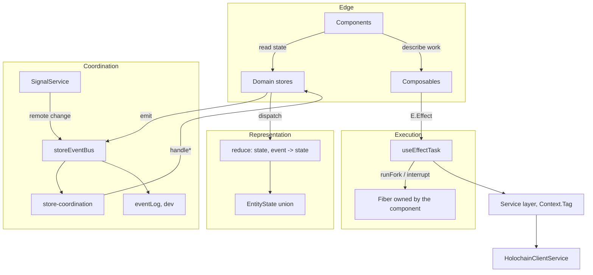
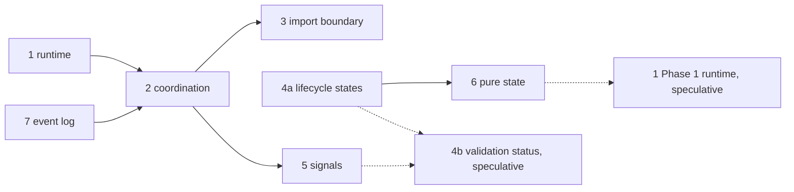

# 0. Unified refactoring design

The seven proposals are not seven refactors. They are one refactor with seven landing points, and reading them separately hides the thesis.

## Thesis

The Requests and Offers frontend coordinates itself implicitly. Eleven stores reach into each other by import, react to each other through subscriptions registered inside store factories, run effects at 161 scattered `run*` call sites and 225 more `runEffect` calls in components, and describe every domain's state with the same three loosely-related fields.
The counts are those of `f5c799ad` on 20 November 2026; [README](README.md) § Verified baseline gives the `git grep` behind each. Each of those is defensible on its own. Together they mean that no single file answers the question "what happens when a user is accepted", and no type prevents a state that cannot exist.

The refactor makes coordination explicit along three axes, and nothing else.

| Axis | Question it answers | Today | After | Proposals |
|---|---|---|---|---|
| **Execution** | Where does an Effect run, and who can stop it? | 161 `run*` call sites, 23 in components, plus 225 `runEffect` calls in components, no cancellation | One task-runner, fibers owned by their component and interrupted on teardown | 1 (Phase 0 only; the runtime half stays deferred) |
| **Coordination** | Where do cross-domain reactions live? | 18 in a store factory, 10 in components, 13 imports, two cycles | One routing table, one import direction, one entry door for local and remote change | 2, 3, 5, 7 |
| **Representation** | What can a domain's state legally be? | `loading: boolean` plus nullable error, three fields, eight combinations | One tagged union of six states, transitions in a pure function | 4a, 6 |

Two pieces sit outside all three and are filed as speculative rather than scheduled. Proposal 4b proposes a state the network does not report. Proposal 1's second phase, a `ManagedRuntime` over a merged layer, is close enough to the `createAppRuntime()` that commit `e31c0324` deliberately removed from this repository in September 2025 that it needs a fresh reason before it is scheduled, and the research did not supply one.

## What the frontend looks like afterwards

Read the arrows: nothing points sideways. Stores do not point at stores, components do not point at the bus, services do not point at stores. Every cycle in the current design becomes a loop through `store-coordination`, which is the one module allowed to know about everything.

## Where each proposal lands in the seven layers

| Layer | Touched by | Change |
|---|---|---|
| 1 Service | 3, 5 | `SignalServiceLive` added; cross-domain deps declared via `Context.Tag`. No aggregating tag: `AppServicesTag` was removed here in 2025 and stays removed |
| 2 Store | 2, 3, 4a, 6 | Split into a pure `state.ts` and a rune wrapper; no store imports a store; no store subscribes cross-domain |
| 3 Schema | 4a, 5 | `EntityState` union; `RoSignal` payload contract |
| 4 Errors | none | Unchanged. The tagged error hierarchy is already right |
| 5 Composables | 1 | Gains `useEffectTask`; owns cross-domain display joins |
| 6 Components | 1, 2, 4a | Run no effects, hold no subscriptions, match on `_tag` |
| 7 Testing | 6, 7 | Reducers testable without a DOM; event log exportable from a failing session |

The seven-layer architecture is not replaced. Layers 1, 3 and 4 barely move. The refactor is almost entirely layer 2, plus a thin new seam at layer 5.

## Invariants after the refactor

**This section is the actual maintainability claim, and it is worth stating plainly: the step up is not in abstraction level, it is that these rules stop depending on whoever remembers them.**

An architecture documented in prose is a convention. Conventions decay at exactly the moments they matter most: under deadline, in an unfamiliar domain, six months after the person who set them wrote them down, and above all in a codebase where one part-time maintainer carries the whole model in their head. Nothing in a document stops a store from importing a store. The reviewer either remembers the rule or does not.

An architecture expressed as checks is different in kind. The rule fires at the moment of violation, addresses whoever is writing the code rather than whoever is reviewing it, and survives the author forgetting it. That is the difference between a design that holds and a design that was once true.

Each invariant below is written so that a machine, not a memory, decides whether it holds. Each is enforceable by lint, grep, or a test. None requires judgment to evaluate.

1. No file under `src/lib/stores/` imports another `*.store.svelte`.
2. No `.svelte` file calls `runPromise`, `runSync`, or `runFork`, or calls `runEffect`, which is `E.runPromise` under another name (`ui/src/lib/utils/effect.ts:8`).
3. No file under `components/` or `routes/`, `.svelte` or `.ts`, imports `storeEvents`, except under `components/hrea/test-page/`.
4. Every cross-domain reaction appears in `store-coordination.ts` and nowhere else.
5. `state.ts` modules import nothing from `svelte`, `effect`, or any service.
6. No store exposes `loading: boolean`.
7. Every effect started from a component is a fiber, and is interrupted on teardown.
8. Local mutations and conductor signals reach stores through the same event vocabulary.
9. State that crosses an effect boundary (a zome call, Electron IPC, storage, `postMessage`) is immutable plain data produced from the Model, never a reactive proxy.

### How each one is enforced

| # | Mechanism | Fails at |
|---|---|---|
| 1 | ESLint `no-restricted-imports`, scoped to `src/lib/stores/**`; until it holds, a ratchet test over store-to-store imports (13 today) | write time, in the editor; the ratchet in `bun run test:unit` |
| 2 | Ratchet test over `grep -rE "run(Promise\|Sync\|Fork)\|runEffect\(" ui/src --include=*.svelte`: 23 direct calls and 225 `runEffect` calls today, and the ceiling may only fall | `bun run test:unit`, in CI |
| 3 | ESLint `no-restricted-imports`, scoped to `components/**` and `routes/**`, with a `hrea/test-page` override; until it holds, a ratchet test (7 importing files and 10 subscriptions today) | write time; the ratchet in `bun run test:unit` |
| 4 | Follows from 1 and 3; no separate check needed | CI, transitively |
| 5 | ESLint `no-restricted-imports`, scoped to `**/state.ts` | write time |
| 6 | Ratchet test over stores that expose `loading` in any form (`git grep -lE 'loading: boolean\|get loading\(\|let loading\b' -- ui/src/lib/stores`): 11 store files today, 10 of them as the literal `loading: boolean` | `bun run test:unit`, in CI |
| 7 | A test that mounts, starts a task, unmounts, and asserts the fiber exit is `Interrupted` | `bun test:unit` |
| 8 | A two-agent e2e assertion that a remote change reaches the UI through the bus | `bun test:e2e` |
| 9 | For zome calls, which are the boundary every write crosses: `toZomePayload` (`ui/src/lib/utils/zome-payload.ts`) at the one place each raw-client call is made, unit tests that send a `$state` proxy and assert `structuredClone` succeeds on what the client receives, and a ratchet entry that every raw-client `callZome({ ... })` sends `null` or `toZomePayload(...)` (holds: 4 calls, 0 without). Storage and `postMessage` carry strings today and have no check yet | `bun run test:unit`, in CI |

Five of the nine are lint or grep, which means they cost close to nothing to run, and they go into CI on the first day as ratchets. They are written to fail loudly and early rather than to be comprehensive: an invariant that needs interpretation is not an invariant.

### The check job: a ratchet test, not a script

Earlier revisions planned `ui/scripts/check-invariants.sh`, red until the codebase earned each line.
That design does not survive contact with the pipeline.
CI's lint step is non-blocking by design (`.github/workflows/ci.yml`, "errors non-blocking"), so a lint rule cannot fail a pull request, and a script that is red until the sweep ends would block every merge for months.
The unit step does block merges, and the repository already enforces architecture as tests: `ui/tests/unit/seam/` walks the import graph to keep exchanges from importing messaging.

The check is therefore `ui/tests/unit/seam/invariants.test.ts`, a ratchet.
It counts invariants 1, 2, 3 and 6 as defined above, against a ceiling equal to today's count, so it is green from the day it lands and fails the moment any count moves.
A rise names what to remove.
A fall fails too and names the ceiling to lower, so the slack a conversion leaves cannot be spent on a new violation elsewhere.
Each conversion pull request lowers its ceiling in the same commit, and an invariant that reaches zero becomes an equality.
Invariant 2 counts `runEffect` as well as `run*`: leaving it out would make the invariant pass on a technicality while 225 Promise-returning calls remain in components, which is the gap #134 came from.
This departs from the "never before" rule this section used to state, whose reason was a red build; a ratchet is never red.

### Invariant 9, and the bug that wrote it

On the desktop app, creating a proposal failed with "Failed to write up the agreement: An object could not be cloned" (#621).
The propose page passed `delivery_timeframe: timeframe`, a `$derived` read of two `$state` values, so the payload held a Svelte proxy.
The desktop wrapper signs zome calls in the Electron main process: the request crosses `ipcRenderer.invoke`, which structured-clones it, and the structured clone refuses a `Proxy`.
The web build and the e2e suite sign inside the page through msgpack, which reads a proxy like any object, so no test saw it.
`useCounterProposal` had already met the same failure and snapshotted by hand (#341); the edit forms carried the latent case.

A rule every call site has to remember is the kind this section exists to retire.
So the rule is stated at the boundary rather than at the call sites: state is reactive inside the page and plain data at its edges.
In the target design the Model is what a pure `reduce` returns ([06](06-pure-state-modules.md)), held in `$state.raw`, and a command that leaves the page carries a value produced from it, never the rune that holds it.
Until every domain is there, `HolochainClientService.callZome`, which every zome call passes, and the client `hrea.service` hands the hREA GraphQL adapter, both run the payload through `toZomePayload`, so a proxy cannot leave the page whichever call site produced it.
It copies arrays and objects (a proxy reads as either, and a class instance is copied to its own fields, which reaches a proxy nested in one where `$state.snapshot` would not), keeps binary hashes and dates as they are, and fixes the payload at call time, so a later edit to the state cannot reach a call in flight.
A new boundary (a worker, a `postMessage` to the Moss host, structured data written to storage) gets the same treatment when it is built: one function at the edge, a test that sends a proxy through it.

## What deliberately does not change

The service layer's `Context.Tag` and `Layer` design. Schema decoding at the zome boundary. The `Data.TaggedError` hierarchy with contexts. Fine-grained Svelte reactivity. SvelteKit routing. The Skeleton design system. The store-helper library under `utils/store-helpers/`, whose cache, record and fetching helpers survive intact; only `event-helpers.ts` narrows to same-domain use.

Foldkit itself is not adopted, and the reason has changed.
Its `peerDependencies` once pinned `effect: 4.0.0-rc.109` exactly, while this project is on `^3.14.18`; `foldkit` 0.171.0 now peers `effect: ~4.1.0`, and the Effect blog post "Devin Jameson Joins Effect" (updated 19 November) says Foldkit is coming under the Effect organisation.
After the Effect 4 migration (U3 in [08](08-implementation-plan.md) § Phase map) the dependency no longer blocks adoption.
The two architectural refusals below do not depend on the Effect version and still stand.
Soushi decided that alpha 3 carries a spike, service types rebuilt on Foldkit beside the current stores and measured against the same unit tests, and a decision on its numbers before Phase 2 starts.
Until then every borrowing here is an idea, never a dependency.

## Three things the comparison settled that shape this design

**The single Model is refused for a sourced reason, not a preference.** Foldkit's own `performance.md` states that the routes of a single app do not code-split, that splitting a program by route "would take design work against the single-Model architecture, not a configuration flag", and that a minimal counter app is roughly 90 KB gzipped with Effect the largest share. For an application with an admin section most users never open, that is the cost that decides it.

**The virtual DOM is refused with Foldkit's own benchmark.** In their published TodoMVC comparison, Svelte optimized is the fastest of fifteen rows at 59.2 ms, Foldkit optimized is seventh at 119.3 ms, and Foldkit unoptimized is last at 352.9 ms. The 3x gap between their own two rows means memoization is mandatory rather than optional on real lists.

**Envelope wrapping is refused because Foldkit ships six lint rules to police it.** `got-submodel-message-name`, `wrap-child-output-in-got-message`, `got-wrapper-carries-only-routing` and three more exist because the convention is easy to get wrong. Proposal 2's routing table gets most of the benefit with none of that.

## Risk register

| Risk | Where | Mitigation |
|---|---|---|
| Moving a subscription changes when it registers, so a boot-time emit is lost | 2 | Audit boot-time emits before moving; coordination initializes in the root layout before any store method is called |
| Breaking a store import cycle changes evaluation order in a way tests do not cover | 3 | Import-order test: import each store first and assert identical behaviour |
| `EntityState` migration touches every component that reads a store | 4a | Derived `data` and `isBusy` getters keep the old surface alive per domain until that domain's components are converted |
| Signals arrive for entries the local agent cannot yet fetch | 5 | Routing is an Effect that may fail; `Stream.catchAll` back into the stream, never tear down |
| Agents receive signals for their own writes | 5 | Suppress by action hash against a short-lived set of locally originated hashes |
| A fiber outlives the component that started it | 1 | `useEffectTask` interrupts its own fiber on teardown |
| Reintroducing an abstraction this repo already rejected | 1 | Phase 1 is speculative; `AppServicesTag` is never reintroduced |
| Nine domains of reducer extraction stalls half-finished | 6 | Gate continuation on a measurement after the first domain, not on principle |

## Why now

The case is not that the current code is bad. It works, and it shipped an alpha. The case is that the next two drops of committed work each add a domain, and every architectural cost gets paid again per domain rather than once.

See [09-pipeline-alignment.md](09-pipeline-alignment.md) for the mapping from each proposal to the open issues and pull requests it serves. The short version: the messaging work needs live signals and per-conversation resource lifecycles, the stewarding drop adds a tenth domain that will read users and administration, the `@holochain/client` 0.22.0 release adds a signal variant, and three alpha-test bugs (#133, #134, #138) were these designs unbuilt: all three are now closed, but #134's bug class, a detail modal that writes after it unmounts, is still in the code (`UserDetailsModal.svelte:34` awaits `E.runPromise`).

## Sequencing

The dependency graph is shallow. Full plan in [08-implementation-plan.md](08-implementation-plan.md).

Proposal 7 moves to the front, against the original note's ordering. It costs about half a week, it is guarded by `dev` so it carries no production risk, and it instruments every phase that follows. Debugging proposal 5 without it means reading `console.log` output for ordering bugs across two agents, which is the exact problem the log exists to solve.
