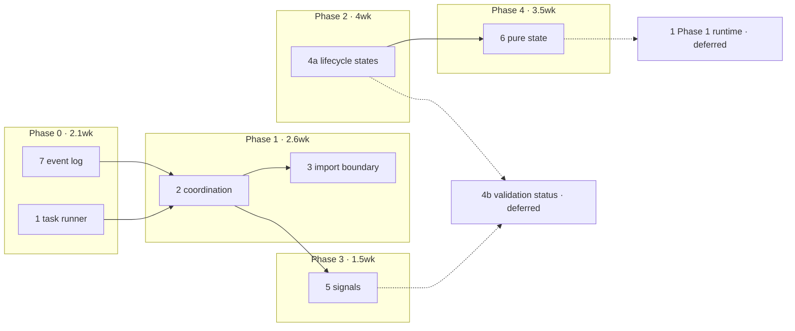

# 8. Implementation plan

Sequencing, effort, gates and pull-request breakdown for the [unified refactoring design](00-unified-refactoring-design.md).

Counts in this plan are those of `f5c799ad` (20 November 2026); [README](README.md) § Verified baseline gives the `git grep` behind each, and § Drift lists D1 to D21, the places an earlier revision disagreed with the code.

## Calibration

Requests and Offers gets roughly ten hours a week, from one person. Estimates below are in **weeks of that allocation**, not in ideal engineering weeks, and they include review and rework. The whole programme is about **13 weeks**, which is close to three months. That number is the most important line in this document, because it means the programme must be valuable in pieces or it should not start.

It is valuable in pieces.
Phases 0 and 1 together are 4.7 weeks (2.1 for Phase 0 and 2.6 for Phase 1, the rows below) and deliver five of the nine invariants: 1, 2, 3, 4 and 7, the five the Phase 1 stopping point lists and the gates check.
Earlier revisions said 4.5 weeks and six invariants, which disagreed with this document's own headings (4.7 weeks) and stopping point (five invariants).
Phase 0 is larger than its 2.1 weeks once `runEffect` is counted (D2): its sweep covers 73 `.svelte` files, not 14, and the estimate has not been re-cut.
Everything after that is optional in the sense that stopping there leaves a coherent codebase rather than a half-migration.

## Dependency graph

Only one edge is hard: coordination must land before the import boundary, because breaking a cycle requires somewhere for the cross-domain write to go. Everything else is preference.

## Phase map

Soushi decided on 20 November 2026 how the phases map onto the releases.
The platform move comes first, and any slice that writes Effect code lands after it, so it is written once.

| Release | Carries |
|---|---|
| **v0.6.0-alpha.2** (tag due 23 November) | Only slices that run no code a member sees: the re-baselined docs, the ratchet test of PR 0.5, and the deletion of the unused Effect and Svelte glue module, the one that exported `useEffectOnMount`, `createStoreInitializer` and ten sibling exports (403 lines, no importer), and the deletion of 11 components (1,135 lines), 4 composables and a guard (1,038 lines) that nothing imports. Nothing else before the UI freeze |
| **v0.6.0-alpha.3** | The platform upgrade, Kit first: U1 Vite 8 on SvelteKit 2 (#303), U2 SvelteKit 3 (#303), U3 Effect 4 (#228). Then Phase 0 and Phase 1, and Phase 3's observation step, PR 3.2, which decodes zome signals into the event log and changes no store. Coordination (Phase 1) is plain TypeScript over the bus and can run alongside the upgrade. The Foldkit spike (service types rebuilt on Foldkit beside the current stores, measured against the same unit tests) runs after U3 and before Phase 2, and the decision is re-opened with its numbers |
| **v0.6.0 final** | Phase 2, the rest of Phase 3, and any remote-signal work |
| **After v0.6.0** | Phase 4 |

#303 and #228 are never in flight together.
The event log (PR 0.1) reads `import.meta.env.DEV`, which Vite replaces with a literal and SvelteKit 3 leaves alone, so it does not wait for U2 (an earlier draft imported `dev` from `$app/environment`, which Kit 3 renames `$app/env`).
`$lib` becomes `#lib` in SvelteKit 3 and rewrites every import line a later slice touches, which is the second reason the slices wait for U2.

## Phase 0. Instrumentation and safety net

**2.1 weeks. No behaviour change. Ships independently.**

This phase inverts the original note's ordering, which put the event log last and opportunistic. It goes first because it costs half a week, is guarded by `dev` so it cannot reach production, and instruments every phase after it. Debugging Phase 3 without it means reading console output for ordering bugs across two agents.

| PR | Title | Est | Files |
|---|---|---|---|
| 0.1 | `feat(ui): add dev-only store event log with JSON export` | 0.5wk | `stores/event-log.ts`, `stores/storeEvents.ts` |
| 0.2 | `refactor(ui): replace emitStatusUpdate console logging with the event log` | 0.2wk | `stores/storeEvents.ts` + 2 call sites |
| 0.3 | `feat(ui): add useEffectTask composable for cancellable component effects` | 0.5wk | `composables/ui/useEffectTask.svelte.ts` |
| 0.4 | `refactor(ui): run component effects through useEffectTask` | 0.8wk, not re-cut | 73 `.svelte` files: 23 `run*` calls in 14 files, and 225 `runEffect` calls in 66 files |
| 0.5 | `test(ui): architecture ratchet, counts may only go down` | 0.1wk | `ui/tests/unit/seam/invariants.test.ts`; no CI workflow change |

PR 0.5 is a ratchet test, not the bash script earlier revisions planned.
CI's lint step is non-blocking by design, and the unit step blocks merges, so a unit test is the only check that can fail a pull request.
The test counts invariants 1, 2, 3 and 6 against ceilings equal to today's counts, so it is green on the day it lands and red the moment a count moves: a rise names what to remove, and a fall names the ceiling to lower, so slack left by a conversion cannot be spent on a violation elsewhere.
Invariant 2 counts `runEffect` as well as `runPromise`, `runSync` and `runFork`, because `runEffect` (`ui/src/lib/utils/effect.ts:8`) is `E.runPromise` under another name.
Each conversion pull request lowers its ceiling in the same commit, and an invariant that reaches zero becomes an equality.
This replaces the earlier rule that a check enters only in the pull request that makes its invariant true, whose stated reason was a red build; a ratchet is never red.
It is the mechanism behind the programme's maintainability claim: the architecture stops depending on whoever remembers it.
Because it carries no runtime code, it lands before the alpha 2 freeze, ahead of the rest of Phase 0.

PR 0.4's scope also covers #134's bug class: `UserDetailsModal.svelte:34` still awaits `E.runPromise`, although #134, #138 and #133 are all closed (D11).

**Gate.** All five claims must hold before Phase 1 starts.

- `git grep -nE 'run(Promise|Sync|Fork)|runEffect\(' -- 'ui/src/**/*.svelte'` returns 0, and the invariant 2 ceiling in `invariants.test.ts` is 0.
- A test mounts a component, starts a task, unmounts, and the fiber's exit is `Interrupted`.
- A production build contains no reference to `__roEventLog`.
- `bun test:unit` passes with no new failures.
- `invariants.test.ts` runs in the unit step of CI and passes.

## Phase 1. Coordination

**2.6 weeks. Behaviour-preserving. The highest value-per-line in the programme.**

| PR | Title | Est | Notes |
|---|---|---|---|
| 1.1 | `feat(ui): add store-coordination module and initialize it in the root layout` | 0.3wk | Empty routing table, wired, no moves yet |
| 1.2 | `refactor(ui): move hREA identity and exchange reactions into coordination` | 0.3wk | A pure move: the 18 `hreaStore.handle*` methods already exist (D7, `hrea.store.svelte.ts:366`), wired through `createEventSubscriptions`. Five of the 18 subscriptions: user, organization, and the three exchange events |
| 1.3 | `refactor(ui): move the remaining hREA reactions into coordination` | 0.3wk | The remaining 13 of the 18 |
| 1.4 | `refactor(ui): components read status, never subscribe` | 0.4wk | 10 sites in 7 files, `NavBar.svelte` and the status-history routes among them; `test-page` exempt |
| 1.5 | `chore(ui): forbid storeEvents imports in components and routes` | 0.2wk | ESLint, with the `test-page` override |
| 1.6 | `refactor(ui): break the administration and users store cycle` | 0.4wk | Decide direction first; administration depends on users |
| 1.7 | `refactor(ui): break the administration and organizations store cycle` | 0.2wk | Same treatment |
| 1.8 | `refactor(ui): move display joins into composables` | 0.4wk | 9 imports, not 4: requests 2, offers 2, `hrea.store` 1, and `messaging.store` 4 (`users`, `exchanges`, `requests`, `offers`); option B in proposal 3. With the four imports of the two cycles of PRs 1.6 and 1.7, these are the 13 imports of invariant 1 |
| 1.9 | `chore(ui): forbid store-to-store imports` | 0.1wk | Should pass on the first run |

**Risk to watch.** PR 1.2 changes when the hREA reactions register: today at module import, afterwards at layout mount. Audit for boot-time emits first. If any exist, coordination initializes earlier rather than the move being abandoned.

**Gate.**

- `grep -rl "storeEventBus.on" ui/src/lib/components ui/src/routes` returns only `test-page` paths.
- `grep -rn "from '\$lib/stores/.*\.store\.svelte'" ui/src/lib/stores/` returns nothing.
- `bun run lint` passes with zero inline disables.
- An import-order test: importing `administration` then `users`, and the reverse, produces identical behaviour.
- Manual two-agent check: accepting a user still creates the hREA agent.

**Stopping point.** Invariants 1, 2, 3, 4 and 7 hold: five of the nine, with 9 already holding for zome calls. If the programme stops here it has paid for itself.

## Phase 2. Representation

**4 weeks. Incremental by construction. Lands in v0.6.0 final, after the platform upgrade, so `EntityState` is written once, in Effect 4's Schema syntax.**

The table below lists the eight domains of the first revision.
There are now 11 store files (D3): `exchanges.store.svelte.ts` and `messaging.store.svelte.ts` are new, and both declare `loading: boolean` (every store exposes `loading`, `weave` through a getter), so Phase 2 has two domains the estimate does not cover.

| PR | Title | Est |
|---|---|---|
| 2.1 | `feat(ui): add EntityState schema and transition helpers` | 0.5wk |
| 2.2 | `refactor(ui): hold service types state as EntityState` | 0.5wk |
| 2.3 | `refactor(ui): match on entity state in service type components` | 0.5wk |
| 2.4 to 2.10 | Same pair, per domain: requests, offers, users, organizations, administration, mediums of exchange, hREA | 2.5wk |

The compatibility surface is what makes this safe: each store keeps `data` and `isBusy` as derived getters, so a converted store works with unconverted components. Delete the getters per domain as its components land.

**Gate per domain**, not per phase.

- A property test over that domain's transitions: no sequence yields a state with both data and an error, and a failed refresh always yields `Stale`.
- A component test: a failed background refresh leaves the previously rendered rows on screen.
- `grep -c "loading: boolean" ui/src/lib/stores/{domain}.store.svelte.ts` returns 0.

## Phase 3. Liveness

**1.5 weeks, frontend only. Revised down from 3 weeks after an audit correction.**

Only PR 3.2, the observation step, is in alpha 3.
PRs 3.3 to 3.5, and any remote-signal work, are in v0.6.0 final.

Six domain coordinator zomes emit a five-variant `Signal` enum from `post_commit` (`administration`, `mediums_of_exchange`, `offers`, `requests`, `service_types`, `users_organizations`).
`exchanges` emits nothing, and `misc`, which owns no entries, does not either.
`messaging` emits a different union, `Signal::Nudge` and `Signal::Receipt`, from `recv_remote_signal` (D8, from #213 and #364).
Since #308 the frontend has one signal listener: `HolochainClientService.onZomeSignal` keeps per-zome handlers across reconnects, and `messaging.store.svelte.ts` registers one, outside `StoreEvents` and so outside invariant 8 (D19).
No handler is registered for the six domain zomes.
The emitting half for those six was built and never connected, so no Rust work is needed to start, and the payload contract is read from the existing enum rather than designed.

| PR | Title | Est | Repo area |
|---|---|---|---|
| 3.1 | `feat(ui): add SignalService on top of onZomeSignal` | 0.5wk | `ui/services/`; the subscription already lives in `onZomeSignal`, so the service may need no scope of its own. **This is where the application runtime is re-decided** (§ Deferred) |
| 3.2 | `feat(ui): decode zome signals and record them in the event log` | 0.3wk | `ui/schemas/`, observation only, no behaviour change |
| 3.3 | `feat(ui): route service type signals into the store event vocabulary` | 0.3wk | `ui/stores/` |
| 3.4 | `test(e2e): two-agent signal propagation for service types` | 0.2wk | `ui/tests/e2e/` |
| 3.5 | `feat(ui): extend signal routing to the remaining five domains` | 0.2wk | `ui/stores/` |
| 3.6 | Optional: `feat(administration): add a StatusChanged signal variant` | 0.3wk | `dnas/`, only if 3.5 proves too coarse |

PR 3.2 is deliberately observation-only: decode and log, change nothing. It proves the Rust-to-TypeScript contract against a running conductor before any store depends on it.

**Version risk.** Issue #193's upgrade to `@holochain/client` `0.21.0` kept the decoded signal field as `payload`; 0.22.0 adds an `AppDirect` signal variant. Decoding in one place makes the next upgrade a one-file change. If the chat work wires signals ad hoc first, it becomes a sweep.

**Decided on 20 November: a change on one agent reaches another agent's UI local first, then through nudges for the two flows that poll today, approval and exchange turn.**
PRs 3.3 to 3.5 wire the zomes' own signals for the agent's own UI.
Then a coordinator change in `administration` and in `exchanges` sends a `Nudge` carrying one `ActionHash` to the agent concerned (the accepted member, the counterparty), and signal routing turns the hash into a fetch and a `StoreEvents` event.
The two polls drop to a fallback for an offline receiver, as `useApprovalWatch` already intends.
No integrity zome changes, so no DNA hash change.
The messaging store's handler moves onto the bus in the same phase, so every remote change enters through one door.
This is remote-signal work, so it lands in v0.6.0 final.

**The gate as first written cannot pass on the signals the six zomes emit (D9), so it is rewritten to match the decision above.**
`post_commit` signals reach only the client of the agent whose call committed; `useApprovalWatch.svelte.ts` says so in its header comment, and doc 05 quotes #181 saying the same.
Cross-agent delivery needs `send_remote_signal`, as `messaging` does with a `Nudge` carrying one `ActionHash`.
The decision above covers two flows, approval (the accepted member) and exchange turn (the counterparty), and does not cover service types, so the gate below tests those two across agents and service types on one agent.
Three polls stand in for it today and name a signal as their replacement (D16): `useApprovalWatch` (15 s, #329), the NavBar exchanges poll, and the messaging badge poll in the root layout.
The `exchanges` store runs uncached for the same reason, and revisits that when signals replace the poll (`exchanges.store.svelte.ts:91-95`).
They are Phase 3's first real consumers.

**Design constraint, restated because it is easy to lose.** Signals reduce latency, they never replace fetching. Holochain signals are send-and-forget with no ordering guarantee and no delivery to an offline receiver. `holochain-open-dev/common` runs a 20 second poll alongside its signal subscriptions for exactly this reason. Cache expiry from Phase 2 remains the correctness mechanism.

**Gate.**

- Two-agent e2e, approval: an administrator accepts a member, and the accepted member's UI reflects it with no manual refresh, through a `Nudge` from `administration`.
- Two-agent e2e, exchange turn: the counterparty's move reaches the other party's UI with no manual refresh, through a `Nudge` from `exchanges`.
- One-agent e2e, service types: an agent's own approval reaches its own stores through the bus from `post_commit`. Another agent's UI still picks it up on its next fetch (D9); no cross-agent push is promised for service types.
- Dropping the websocket mid-stream releases and re-acquires the scoped subscription with no duplicate handlers.
- Echo test: an agent's own write applies exactly once.
- The event log from a two-agent session shows `origin: 'signal'` entries interleaved correctly.

## Phase 4. Purity

**3.5 weeks, and the only phase that should be re-decided rather than executed.**

| PR | Title | Est |
|---|---|---|
| 4.1 | `refactor(ui): extract service types state into a pure reducer` | 0.7wk |
| 4.2 | `test(ui): property tests for the service types reducer` | 0.3wk |
| **4.3** | **Decision point, not a PR** | 0 |
| 4.4 to 4.11 | One domain per PR, eight remaining | 2.5wk |
| 4.12 | Not scheduled. See Deferred | 0 |

Phase 4 comes after v0.6.0.
The measurement in 4.3 starts from a larger suite than the first revision assumed: 132 unit test files and 1,720 tests today, where the first revision read 268 (D17).

**The decision point is the plan's main safeguard.** After 4.1 and 4.2, measure two numbers: how many existing Service Types tests became redundant, and how many real defects the property tests found that the example tests missed. Continue on those numbers. Continuing on principle is how a nine-domain migration stalls at four.

**Gate.**

- `state.ts` modules import nothing from `svelte`, `effect`, or any service, enforced by lint.
- Reducer suites run without a DOM environment.
- No new store-to-store or aggregating-tag dependencies appear.

## Deferred

**Proposal 1, Phase 1: the application runtime.** Not scheduled. This repository built `createAppRuntime()` with an aggregating `AppServicesTag` in 2025 and removed it in `e31c0324` on 2025-09-29, deleting roughly 2,530 net lines including an 898-line test file, on the stated grounds that the abstraction was complex and the simpler form kept full functionality. The design proposed in [01](01-application-runtime.md) is narrower than what was removed, since it never reintroduces the aggregating tag, but it is close enough to need a fresh reason. The research did not supply one: layers are already built once at module scope, so a `ManagedRuntime` would buy a policy seam and a disposal hook rather than the performance win it is usually sold for. Revisit if Phase 3's scoped websocket subscription turns out to want an owner with a defined disposal point.
Soushi decided it stays deferred and is re-decided at PR 3.1, with a concrete need in hand.
The case got weaker rather than stronger: since #308, `onZomeSignal` is a narrow owner that already carries the subscription across reconnects, with no runtime.
Phase 0's task runner is unaffected and stays scheduled.

**4b, DHT validation status.** Not scheduled. It proposes states the network does not report: signals fire from `post_commit` at source-chain write time, and validation status is reachable only by calling `get_details` per record. Building it means a coordinator zome function per entry type, a polling scheduler with backoff, and six states to render. Revisit only if a user-facing requirement appears that the cheaper two-state approximation (`Pending` / `Settled`, using data the frontend already has) cannot serve.
Soushi gated it on a Sweettest experiment: whether `get_details` can return a record that is still pending validation, and what it reports, is answered first.
No design work on 4b starts before that answer.

## Fit with the release train

The project is on v0.6.0-alpha.1 (`package.json`), with alpha 2 due to be tagged on 23 November, and v0.6.0 final to follow alpha 3.
The first revision targeted v0.6.x patches, v0.7.0 and v0.7.x, which predate the alpha naming (D14); the [phase map](#phase-map) above replaces that table.
Nothing in Phases 0 through 2 changes user-visible behaviour, so all of it can land on `dev` alongside feature work.
Phase 3 changes behaviour but not the DNA hash (D10), so it needs no network reset on its own account; the reset window matters only for an integrity change.

| Phase | Target |
|---|---|
| Platform upgrade (U1 to U3) | v0.6.0-alpha.3 |
| 0, 1 | v0.6.0-alpha.3, Phase 1 alongside the upgrade |
| 3, PR 3.2 only | v0.6.0-alpha.3 |
| 2 | v0.6.0 final, one domain per pull request |
| 3, the rest, and any remote-signal work | v0.6.0 final |
| 4 | after v0.6.0, internal only |

Total is about **13 weeks** by the first revision's estimate, before the platform upgrade (about 3 weeks, an unmeasured estimate), the Foldkit spike (about half a week), and the `runEffect` sweep.
Phase 4's runtime step is removed, and Phase 3 was halved once the audit found the zomes already emit signals.

## Tracking

Every PR title above is written to be pasted as an issue title. If these are filed, the natural shape is one GitHub issue per phase as a tracking issue, with the PR rows as its checklist, rather than 30 separate issues. That keeps the board readable at ten hours a week.

The nine invariants in the [unified design](00-unified-refactoring-design.md) are the acceptance criteria for the programme as a whole, and the ratchet test introduced in PR 0.5, `ui/tests/unit/seam/invariants.test.ts`, is where they live. Five of the nine are lint or grep, so they cost almost nothing to run. Its ceilings fall in the pull request that earns each drop.

That fall is the honest progress metric for this programme. Not weeks elapsed, not documents written: how many of the nine rules a machine now enforces without anyone remembering to.
